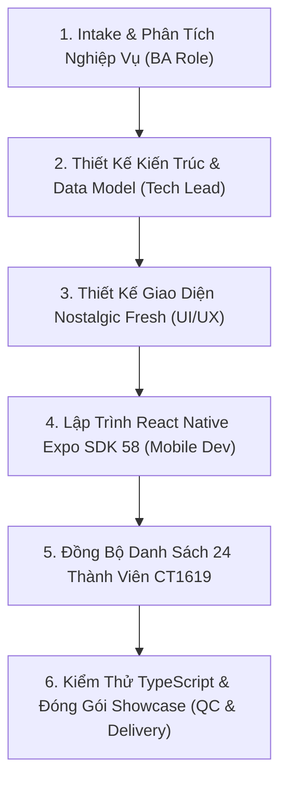
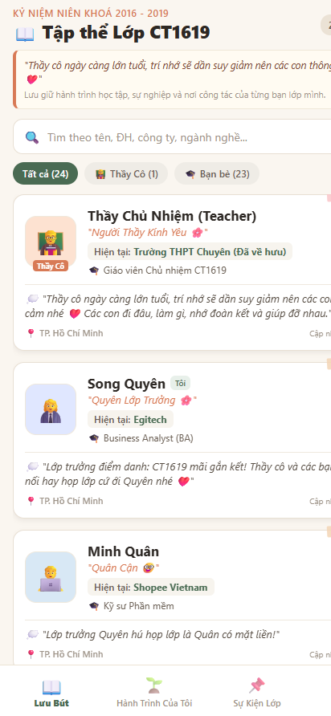
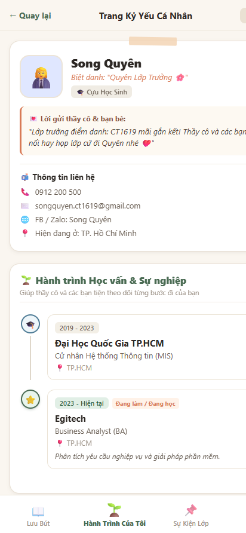
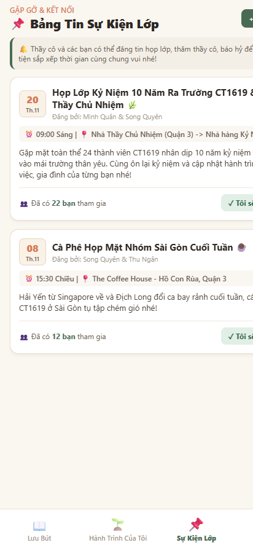
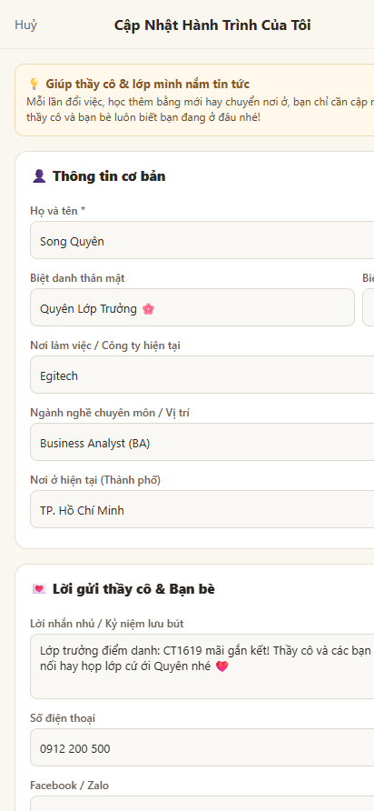

# Báo Cáo Thực Thi Dự Án: Sổ Lưu Bút Kỷ Yếu Mobile App — Lớp CT1619
> **Thực hiện theo BA Agent Framework v3.0 (Chỉ đạo & Training bởi anh Công)**
> **Người thực hiện:** Song Quyên (Lớp trưởng CT1619 / Business Analyst tại Egitech) phối hợp cùng AI Agent Pair Programming.

---

## 1. Mục Tiêu & Bài Toán Thực Tế (Problem Statement)
- **Ý tưởng khởi nguồn:** Sau nhiều năm ra trường, thầy cô ngày càng lớn tuổi và trí nhớ dần suy giảm; mỗi lần gặp lại, thầy cô và các bạn khó nhớ hết ai học trường nào, đang làm công ty gì hay vừa đổi việc qua đâu.
- **Giải pháp đề xuất:** Xây dựng một ứng dụng Mobile Lưu Bút mang phong cách **Nostalgic Fresh (hoài niệm vintage ấm áp mà hiện đại)**, giúp:
  1. Từng thành viên chủ động cập nhật hành trình học tập, sự nghiệp và nơi công tác khi đổi việc.
  2. Thầy cô và bạn bè tra cứu nhanh danh bạ 24 thành viên lớp CT1619.
  3. Bảng tin sự kiện họp lớp, thăm thầy cô 20/11 có tính năng xác nhận tham gia.
  4. Kiến trúc **In-App Offline First (Không BE)** để đảm bảo riêng tư tuyệt đối cho lớp học, không tốn chi phí máy chủ và có cơ chế Sync JSON chia sẻ qua Zalo/AirDrop.

---

## 2. Quy Trình Thực Thi End-to-End Bằng Bộ Harness (`BA_AGENT_FRAMEWORK`)

### Các mốc bàn giao cụ thể theo chuẩn v3.0:
1. **SRS (Software Requirements Specification):** Lập đặc tả tại [`BA_NOTE/ACTIVE/projects/P001-LuuBut/SRS.md`](file:///C:/Users/Song%20Quyen/LuuBut_App/BA_NOTE/ACTIVE/projects/P001-LuuBut/SRS.md) quy định chi tiết 4 yêu cầu chức năng (REQ-001 đến REQ-004) và 3 yêu cầu phi chức năng NFR.
2. **DECISIONS:** Ban hành quyết định kiến trúc tại [`DECISIONS.md`](file:///C:/Users/Song%20Quyen/LuuBut_App/BA_NOTE/ACTIVE/projects/P001-LuuBut/DECISIONS.md):
   - `DEC-001`: Kiến trúc In-App Local Storage + Chia sẻ Offline JSON.
   - `DEC-002`: Design System Retro Paper (màu giấy kraft `#FAF6F0`, washi tape, kẹp ảnh polaroid).
3. **Nâng Cấp Expo SDK 58:** Đảm bảo mã nguồn tương thích hoàn toàn với ứng dụng Expo Go mới nhất trên iOS / Android.
4. **Data Lớp CT1619:** Tích hợp đúng 24 nhân sự từ kho tư liệu `CT1619` với thông tin chuẩn xác:
   - **Song Quyên:** Lớp trưởng CT1619 — Business Analyst (BA) tại Egitech.
   - Thầy Chủ Nhiệm và 22 bạn bè với đầy đủ chặng đường đại học và nơi làm việc hiện tại.

---

## 3. Ảnh Chụp Màn Hình Giao Diện Mobile App (UI Showcase)

### 3.1. Danh Bạ Sổ Lưu Bút 24 Thành Viên CT1619
Giao diện thẻ kẹp sổ tay retro, hiển thị nhanh công ty và ngành nghề hiện tại cùng lời nhắn nhủ gửi thầy cô:

### 3.2. Trang Hành Trình Cá Nhân (Lớp Trưởng Song Quyên)
Cây thước kẻ Timeline ghi nhận từng mốc học tập tại ĐHQG TP.HCM và công tác tại Egitech:

### 3.3. Bảng Tin Sự Kiện Lớp
Thông báo họp lớp kỷ niệm 10 năm ra trường và cà phê họp mặt cuối tuần:

### 3.4. Màn Hình Cập Nhật Khi Đổi Việc / Đổi Ngành
Biểu mẫu thêm mốc hành trình mới tiện lợi, cập nhật ngay công việc hiện tại vào máy:

---

## 4. Đóng Gói Bàn Giao & Hướng Dẫn Truy Cập

- **Thư mục dự án cục bộ:** `C:\Users\Song Quyen\LuuBut_App`
- **Trang Website Showcase End-to-End:** Đã tạo tại `C:\Users\Song Quyen\LuuBut_App\docs_showcase\index.html` (đã mở sẵn trên trình duyệt để trình chiếu cho anh Công và các bạn).
- **Mã nguồn Git:** Đã khởi tạo Git repository cục bộ và commit toàn bộ lịch sử với thông điệp:
  `feat: practiceagent1.0 - LuuBut Mobile App CT1619 with End-to-End BA Agent Framework showcase`
